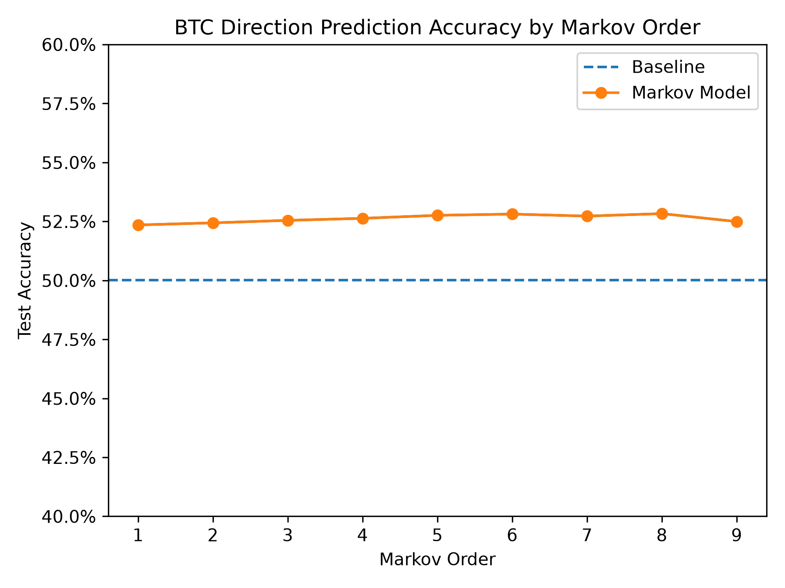

# Experiment 01: Higher-Order Markov Chains

## Objective

The goal of this experiment is to investigate whether historical Bitcoin price movements contain information that can be used to predict the direction of the next 15-minute period.

Specifically, this experiment examines whether increasing the order of a Markov chain improves directional prediction accuracy.

The motivation for this project is to explore the potential application of stochastic models to binary prediction markets, where the outcome depends on whether Bitcoin's price increases or decreases rather than the magnitude of the change.

## Dataset

Historical BTC/USDT data was obtained from the [15-Minute BTC/USDT Dataset on Kaggle](https://www.kaggle.com/datasets/felixvo/15m-btcusdt).

- **Total observations:** 183,073
- **Frequency:** 15-minute intervals
- **Training data:** First 80% of observations
- **Testing data:** Remaining 20% of observations

Each observation is classified according to the change in closing price between consecutive periods:

$$
X_t =
\begin{cases}
U & \text{if } C_t > C_{t-1} \\
D & \text{if } C_t \leq C_{t-1}
\end{cases}
$$

where $C_t$ represents the closing price at time $t$.

Unchanged closing prices are currently classified as Down.

This produces a sequence of binary states used to estimate transition probabilities.

## Methodology

### Higher-Order Markov Chains

A first-order Markov chain assumes that the probability of the next state depends only on the current state:

$$
P(X_{t+1}\mid X_t)
$$

This experiment extends the model to incorporate the previous $n$ movements:

$$
P(X_{t+1}\mid X_t,X_{t-1},\ldots,X_{t-n+1})
$$

For a model of order $n$, there are $2^n$ possible historical patterns, each with two possible subsequent outcomes.

For example, a second-order model considers the patterns:

- `UU`
- `UD`
- `DU`
- `DD`

The model estimates the probability of an upward or downward movement following each pattern.

### Transition Probability Estimation

Transition probabilities are estimated using observed frequencies in the training data.

For a historical pattern $s$, the probability of an upward movement is estimated as:

$$
\hat{P}(U\mid s)=
\frac{N(s,U)}{N(s,U)+N(s,D)}
$$

Similarly:

$$
\hat{P}(D\mid s)=
\frac{N(s,D)}{N(s,U)+N(s,D)}
$$

where $N(s,U)$ and $N(s,D)$ represent the number of times pattern $s$ is followed by Up and Down, respectively.

For each prediction, the model selects whichever outcome has the higher estimated conditional probability.

### Training and Testing

The data was divided chronologically into training and testing sets using an 80/20 split.

The models were trained exclusively on the first 80% of the observations, with the remaining 20% used to evaluate predictive accuracy.

Nine Markov models were evaluated, with orders ranging from 1 through 9.

### Baseline Model

A constant-direction baseline was implemented for comparison.

The baseline determines whether Up or Down occurs more frequently in the training set and always predicts that direction on the test set.

Its accuracy is calculated as:

$$
\text{Baseline Accuracy}
=
\frac{\text{Correct Predictions}}{\text{Total Test Observations}}
$$

### Evaluation Metric

Each model was evaluated using classification accuracy:

$$
\text{Accuracy}
=
\frac{\text{Correct Predictions}}{\text{Total Predictions}}
$$

Because higher-order models require more preceding observations, the number of evaluated predictions differs slightly by model order.

## Results

### Prediction Accuracy

| Model | Test Accuracy |
|---|---:|
| Baseline | 50.0150% |
| 1st-Order Markov | 52.3516% |
| 2nd-Order Markov | 52.4404% |
| 3rd-Order Markov | 52.5456% |
| 4th-Order Markov | 52.6317% |
| 5th-Order Markov | 52.7588% |
| 6th-Order Markov | 52.8122% |
| 7th-Order Markov | 52.7262% |
| 8th-Order Markov | **52.8314%** |
| 9th-Order Markov | 52.4941% |

All nine Markov models outperformed the constant-direction baseline on the historical test set.

Accuracy generally increased with model order through order 8, although the improvement was not monotonic.

The eighth-order model achieved the highest observed accuracy at 52.8314%, approximately 2.82 percentage points above the baseline.

### Accuracy Visualization

The graph displays prediction accuracy as a function of Markov order, with the constant-direction baseline included for comparison.

### Performance Across Test Periods

To investigate whether the first-order model's performance was consistent over time, the test dataset was divided into 10 consecutive segments.

The original transition probabilities were retained, and prediction accuracy was calculated separately for each segment.

| Test Period | Accuracy |
|---|---:|
| 1 | 54.23% |
| 2 | 54.59% |
| 3 | 52.38% |
| 4 | 51.53% |
| 5 | 51.45% |
| 6 | 49.45% |
| 7 | 51.12% |
| 8 | 51.94% |
| 9 | 52.76% |
| 10 | 54.11% |

The first-order model achieved accuracy above 50% in 9 of the 10 test periods.

The highest accuracy was 54.59% in period 2, while the lowest was 49.45% in period 6.

These results suggest that the model's directional accuracy was relatively consistent across the evaluated historical periods, although performance varied over time.

## Discussion

### Effect of Markov Order

The results indicate that incorporating additional historical movements can improve directional prediction accuracy on the evaluated dataset.

The first-order model achieved 52.35% accuracy, while the eighth-order model achieved 52.83%.

However, this improvement is relatively small considering the substantial increase in the number of possible historical patterns.

For an order-$n$ model, the number of patterns grows exponentially:

$$
\text{Number of Patterns}=2^n
$$

An eighth-order model requires estimating probabilities for 256 historical patterns, compared with only two patterns for a first-order model.

As the model order increases, fewer training observations may be available for individual patterns, potentially increasing the variance of the estimated probabilities.

The decline in accuracy at order 9 may reflect overfitting or sampling variation, although additional experiments would be required to determine the cause.

### Directional Predictability

The initial first-order transition estimates indicated that reversals between Up and Down movements occurred slightly more frequently than continuations.

This suggests a possible short-term reversal tendency in the signs of 15-minute BTC returns within the historical dataset.

However, the results do not establish that this relationship is stable across different market conditions or future observations.

### Implications for Prediction Markets

The long-term motivation for this project is to investigate models relevant to binary prediction markets.

In these markets, the outcome may depend on price direction rather than the magnitude of the movement.

Consequently, estimating the probability of an upward or downward movement is potentially useful.

However, classification accuracy alone is insufficient to evaluate whether a model offers an advantage over market prices.

A model's estimated probabilities must also be evaluated for calibration and compared against actual contract prices, transaction costs, and settlement rules.

## Limitations

Several limitations should be considered when interpreting these results.

1. **Model Selection Bias:** Multiple Markov orders were evaluated using the same test dataset. Selecting the best-performing order based on these results introduces model-selection bias.

2. **Limited Features:** Models use only the direction of previous price movements, ignoring information such as return magnitude, trading volume, and volatility.

3. **Probability Calibration:** The experiment evaluates directional accuracy but does not determine whether estimated transition probabilities accurately reflect observed outcome frequencies.

4. **Changing Market Conditions:** Transition probabilities may vary over time, and relationships observed in the historical dataset may not persist in future periods.

5. **Unchanged Prices:** Price movements with no change in closing price are classified as Down, potentially introducing a small bias.

6. **Prediction Market Settlement:** The BTC/USDT closing prices used in this experiment may not match the price sources or settlement procedures of specific prediction markets.

7. **Profitability:** Directional prediction accuracy does not directly establish trading profitability or positive expected value.

## Conclusion

This experiment investigated the predictive performance of higher-order Markov chains on historical 15-minute Bitcoin price movements.

All nine evaluated Markov models outperformed the constant-direction baseline on the original test dataset.

The highest observed accuracy was 52.8314%, achieved by the eighth-order model, compared with a baseline accuracy of 50.0150%.

The results provide preliminary evidence of directional dependence in the analyzed historical data. However, the improvements associated with higher-order models were relatively small, and further validation is required before concluding that these patterns generalize.

The primary outcome of this experiment is establishing a reproducible baseline for future comparisons with statistical and machine learning models.

## Future Work

The next stages of the project will focus on:

- Implementing chronological training, validation, and test partitions.
- Evaluating probability calibration, log loss, and Brier score.
- Investigating whether model performance is stable across different historical periods.
- Comparing Markov chains against logistic regression.
- Introducing additional features such as previous returns, volatility, and volume.
- Evaluating tree-based models and neural networks.
- Investigating the relationship between model probabilities and prediction-market prices.
